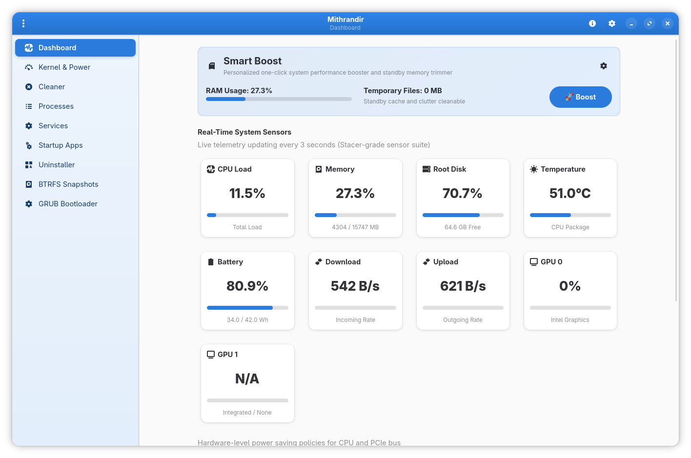
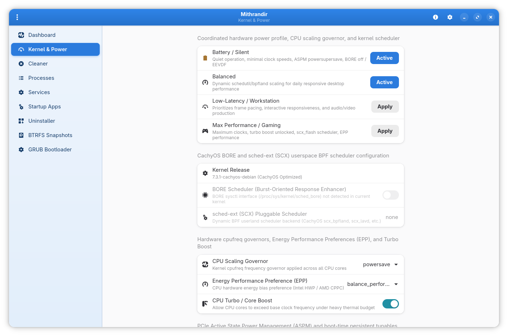
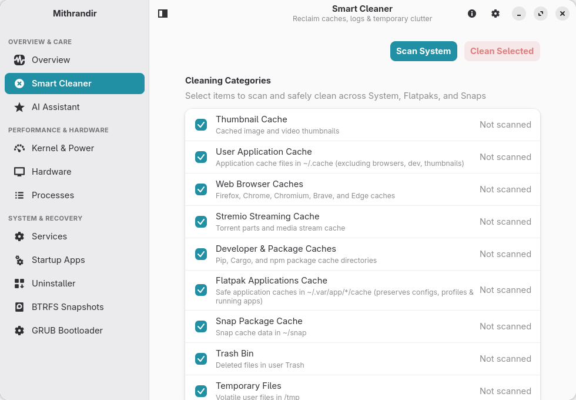
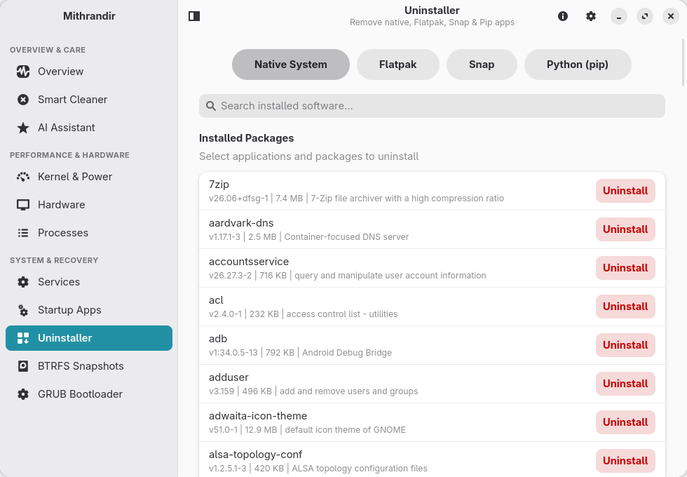
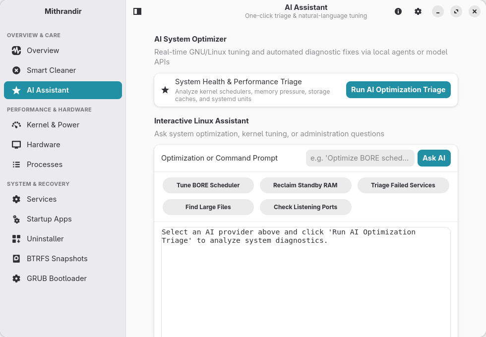
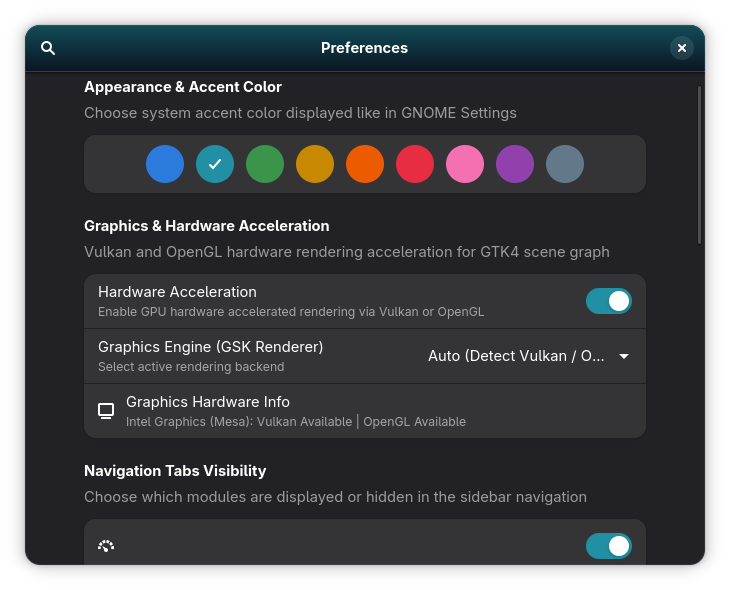
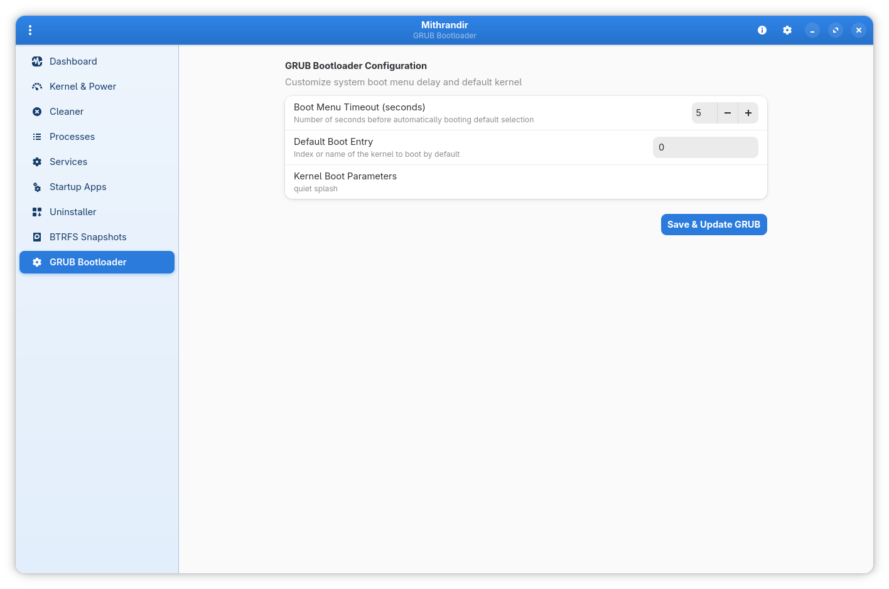

<p align="center">
  
</p>

<h1 align="center">Mithrandir 🦀</h1>

<p align="center">
  <strong>Native GTK4 & Libadwaita GNU/Linux System Optimizer, Deep Cleaner, BORE Scheduler & Power Manager</strong><br>
  <em>Blazing-fast native execution, instant startup, and low memory overhead written in Rust.</em>
</p>

<p align="center">
  <a href="#-installation"></a>
  <a href="https://www.gnu.org/licenses/gpl-3.0"></a>
  <a href="https://gtk.org/"></a>
  <a href="https://www.rust-lang.org/"></a>
  <a href="https://github.com/Antux912012/mithrandir"></a>
</p>

---

> [!IMPORTANT]
> **Trademark & Non-Affiliation Disclaimer**: Mithrandir is an independent open-source utility developed by Antonio (`Antux912012`) and is not affiliated with, endorsed by, or sponsored by the CachyOS, GNOME, Debian, Fedora, or Arch Linux projects.

**Mithrandir** is a blazing-fast, native system optimizer, deep cleaner, telemetry monitor, BORE kernel scheduler controller, and hardware power optimizer written in **Rust** with **GTK4** and **Libadwaita**, engineered for instant startup, minimal memory footprint, and robust multi-distribution compatibility.

> [!NOTE]
> **What's New in v1.1.2:**
> - 🚀 **Streamlined Kernel & Power Management**: Focused kernel tuning around BORE (`sched_bore`), CPU frequency scaling governors, Energy Performance Preferences (EPP), Turbo Boost, and PCIe ASPM (removed `sched-ext` / SCX integration and bundled archives).
> - 📦 **Flathub Policy & AppStream 1.0 Compliance**: Updated AppStream metadata (`io.github.antux912012.Mithrandir.metainfo.xml`), sandbox permissions, and Flatpak packaging to adhere to Flathub guidelines.
> - 🧹 **Hardened Flatpak Cache Safety**: Strict XDG sandbox boundary validation ensuring `config/`, `data/`, and `.local/state/` are never touched.
> - ⚡ **Mithrandir Presets**: One-click switching across 4 profiles (Battery/Silent, Balanced, Low-Latency/Workstation, Gaming).

---

## 📸 Screenshots

| 📊 Real-Time Dashboard & Telemetry | ⚡ Kernel & Power Management |
| :---: | :---: |
|  |  |

| 🧹 Multi-Category Deep Cache Cleaner | 📦 Multi-Backend Package Uninstaller |
| :---: | :---: |
|  |  |

| 🤖 Multi-Provider AI Optimizer & Agents | ⚙️ GNOME 47 Accent Colors & Acceleration |
| :---: | :---: |
|  |  |

<p align="center">
  
</p>

---

## ⚡ Current Feature Matrix

| Feature / Area | Capabilities | Status |
| :--- | :--- | :--- |
| **System Dashboard & Telemetry** | CPU, Dual GPU, Network Rx/Tx, Thermal Zones, Battery Wh/Health, Host Specs | ✅ Active |
| **Hardware Inspection & Guide** | Check Your Hardware integration: Battery FRU/health, NVMe/SATA, RAM SODIMM, EDID display, PCI network & parts replacement | ✅ Active |
| **Kernel Scheduler & Power** | BORE runtime/persist toggle, CPU scaling governors, EPP, Turbo Boost, PCIe ASPM | ✅ Active |
| **Smart Boost (RAM & Cache trim)**| Standby cache trimming, debounced re-entrancy guard, automated threshold daemon | ✅ Active |
| **Multi-Threaded Cache Cleaner** | Thumbnails, Browser, Stremio, Dev, Trash, Journal, Flatpak sandbox safe cache | ✅ Active |
| **Process & Task Explorer** | Live accurate CPU% & RAM, filter, search, kill/terminate signals | ✅ Active |
| **Startup Applications** | XDG desktop autostart entry management | ✅ Active |
| **Systemd Services Manager** | Unit inspection, start/stop/restart, and live systemd service status | ✅ Active |
| **Package Uninstaller** | APT, DNF, Pacman, Flatpak, Snap, and Pip package management | ✅ Active |
| **System Tray & Background Mode** | Pure Rust StatusNotifierItem (SNI) + DBusMenu with auto dark/light theme | ✅ Active |
| **BTRFS Snapshots** | Automated snapshots, subvolume inspection & rollback management | ✅ Active |
| **GRUB Bootloader** | Kernel parameters, boot timeouts & default entry selection | ✅ Active |

---

### 🛡️ System Tray & Background Architecture (GTK4 + Pure Rust D-Bus)

Standard `libappindicator` links against GTK3 (`GtkMenu`), which causes fatal runtime symbol conflicts when loaded into a GTK4 process. Mithrandir solves this natively:
- **Pure Rust D-Bus SNI (`ksni`)**: Implements `org.kde.StatusNotifierItem` and `com.canonical.dbusmenu` entirely in Rust without GTK3 C bindings.
- **Freedesktop Symbolic Icons**: 16x16 monochrome symbolic icon (`mithrandir-status-symbolic.svg`) with transparent background that automatically adapts to both dark and light desktop panels.
- **Seamless Window Interception**: Closing the window hides it (`set_hide_on_close(true)`) while keeping the `GApplication` event loop active via `app.hold()`.
- **Tray Menu Actions**:
  1. **Run Smartboost**: Triggers RAM and disk cache reclamation with desktop notifications and re-entrancy locking.
  2. **Battery Power Saver**: Hardware-level power optimization toggle synced bidirectionally between the GTK4 UI and panel menu.
  3. **Open Mithrandir**: Restores and focuses the main Libadwaita window.
  4. **Quit Mithrandir**: Cleanly shuts down background threads and exits the application.
- **Autostart & Background Launch**: Pass `--background` or `--minimized` to initialize the app in the background without popping up the main window.

### ⚡ Hardware Power Saver & Multi-Distro Adaptability (`src/os_info.rs`)

Mithrandir includes hardware-level battery and power saving controls synced across the Libadwaita UI and the panel indicator:
- **Intel P-State & CPU EPP**: Toggles `intel_pstate/no_turbo` (`"1"` vs `"0"`) and dynamically switches CPU Energy Performance Preference (`energy_performance_preference`) between `"power"` and `"balance_performance"`.
- **PCIe ASPM**: Switches PCIe Active State Power Management policy to `"powersupersave"` for deep NVMe and bus power management.
- **Zero-Password Udev Optimization**: Generates `99-mithrandir-power.rules` dynamically targeting the correct administrative group (`wheel` for Fedora/Arch/openSUSE, `sudo` for Debian/Ubuntu).
- **SELinux & Immutability Awareness**: Native `/etc/os-release` detection (`src/os_info.rs`) automatically recognizes NixOS and immutable trees, gracefully skipping direct `/etc` modifications with clear user guidance.

### 🔒 Flatpak Sandbox Permissions

When packaged as a Flatpak (`io.github.antux912012.Mithrandir`), Mithrandir requests the following permissions:
- `--filesystem=home` and `--filesystem=~/.var/app`: Required to scan and clean user caches, thumbnails, developer build caches, XDG autostart entries, and per-app Flatpak caches (`~/.var/app/*/cache` only).
- `--talk-name=org.freedesktop.Flatpak`: Required to bridge system diagnostics, package management, BTRFS snapshots, and GRUB/kernel operations to the host via `flatpak-spawn --host`.
- `--system-talk-name=org.freedesktop.systemd1`, `--system-talk-name=org.freedesktop.UPower.PowerProfiles`, `--system-talk-name=net.hadess.PowerProfiles`: Required for systemd service inspection and system power profile switching.
- `--talk-name=org.kde.StatusNotifierWatcher`: Required for StatusNotifierItem system tray integration.

---

## 📦 Installation

Pre-built standalone packages are ready in the repository root:

### Flatpak Bundle (`.flatpak`)
Install the sandboxed single-file bundle:
```bash
flatpak install --user mithrandir_1.1.2.flatpak
```
Run via Flatpak:
```bash
flatpak run io.github.antux912012.Mithrandir
```

### Debian / Ubuntu Package (`.deb`)
```bash
sudo dpkg -i mithrandir_1.1.2_amd64.deb
```

### AppImage (`.AppImage`)
Run instantly on any modern GNU/Linux distribution:
```bash
chmod +x ./mithrandir-1.1.2-x86_64.AppImage
./mithrandir-1.1.2-x86_64.AppImage
```

### Arch Linux / CachyOS (AUR)
```bash
# Using an AUR helper
yay -S mithrandir
# Or building manually from packaging/aur
cd packaging/aur && makepkg -si
```

---

## 🚀 CLI Usage

Mithrandir can be run as a full Libadwaita GUI app or invoked directly from the terminal:

```bash
# Launch the Libadwaita GUI
mithrandir

# Launch minimized directly into the system tray / background
mithrandir --background

# Perform instant one-click performance boost
mithrandir --smart-boost

# View live system telemetry
mithrandir --monitor

# Inspect CachyOS BORE kernel & power status
mithrandir --kernel

# Scan cleanable clutter and caches
mithrandir --clean
```

---

## 🛠️ Building from Source

### Quick Build with Makefile
```bash
# Build all targets (release binary, Flatpak, Deb, AppImage)
make all

# Build only the Flatpak bundle
make flatpak

# Build only the Debian package
make deb

# Build only the AppImage package
make appimage

# Run unit & integration test suite
make test
```

---

## 🔮 Project Roadmap & Future Rebranding

- **Deprecation of Standard Mithrandir**: The legacy Python/GTK4 version ([Mithrandir](https://github.com/Antux912012/mithrandir)) has been superseded by this native Rust implementation.
- **Continuous Improvements**: Active feature development, deep hardware integrations, system cleaners, and package management continue exclusively in Mithrandir.
